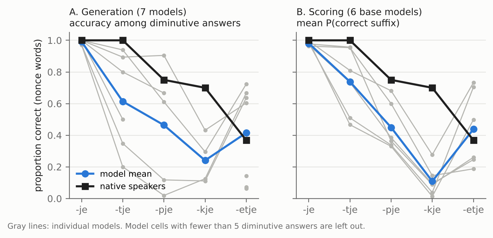

# Do language models generalise Dutch diminutives like native speakers?

A wug test of the five Dutch diminutive allomorphs (*-je, -tje, -pje, -kje, -etje*) given to
native speakers and to open language models, with the same nonce words, the same answer coding
and the same error analysis.

The human study (26 native speakers, 8 L2 learners, 15 nonce words) was run with Giancarlo Grillo
and supervised by Dr Eva van Lier (University of Amsterdam). This repository extends it to 11 open
model checkpoints (EuroLLM, Gemma 4, Fietje 2; 1.7B to 12B parameters).



## Main findings

- **Different difficulty profiles.** Native speakers find *-etje* hardest (7/19 correct). Every
  model finds *-kje* hardest, in generation and in log-probability scoring alike (mean
  P(*-kje*) .01 to .28 for nonce words, against 14/20 for native speakers).
- **Stress is ignored.** For *-kje* targets, 52% of the models' diminutives use *-etje*
  (*toddingetje* for *toddinkje*), against 15% for native speakers. This is the pattern for stressed
  *-ng* (*ringetje*) applied to unstressed *-ing* (*koninkje*).
- **Error patterns vary.** Native speakers' *-etje* errors mostly follow the stem-final consonant
  (9/12, e.g. *kempje*). For models this ranges from 0/15 to 18/18 and depends strongly on the
  item.
- **Real words are slightly easier** (0 to 13 points), and EuroLLM 9B beats 1.7B. Larger Gemma
  models are not consistently better, and the Dutch-specific Fietje 2 is not more accurate than
  general models of similar size.

With three nonce words per suffix and a small, informally recruited human sample, these are
descriptive patterns rather than tested differences. See [Limitations](#limitations).

## Research questions

1. How accurate are models per suffix, and do they rank the suffixes by difficulty as native
   speakers do?
2. Do models' *-etje* errors follow the stem-final consonant, as the human errors do?
3. How large is the gap between real words and nonce words?
4. (Exploratory) Does accuracy depend on model size or on Dutch-specific training?

## Design

| | Method A: generation | Method B: scoring |
|---|---|---|
| Models | 5 instruct models + 2 base models | 6 base models |
| Task | 5 prompt templates (3 mirror the human task, 1 metalinguistic, 1 few-shot) | P(suffix \| stem) over the 5 candidate forms after *Dit is een X. Dit is een heel klein ...* |
| Runs | 1 greedy + 10 samples (T = 0.7) per prompt; 13,475 outputs | one forward pass per candidate and context |
| Analysis | rule-based coding (same scheme as the human answers), accuracy among diminutive answers | mean P(correct), top-1 accuracy |

Stimuli: 15 core nonce words (3 per suffix, generated with Wuggy), 51 reserve nonce words and 20
real words. All open models run in 4-bit NF4 on a single Colab T4 GPU, and the exact model
revisions are recorded in [`outputs/raw/MODEL_REVISIONS.md`](outputs/raw/MODEL_REVISIONS.md).
A runner for one closed API model (Claude Sonnet 5.5, generation only) is included but has not
been run yet.

The automatic coder was checked against 210 manually coded outputs: 91.0% agreement on the answer
strategy, Cohen's κ = .89.

Full details of every step are in [`docs/METHODS.md`](docs/METHODS.md).

## Repository structure

```
config/        model list, decoding settings, prompt templates
data/stimuli/  nonce words, real words, candidate forms
data/human/    anonymised aggregate human results (no trial-level data)
src/wug/       the Python package: stimuli, coding, prompts, model runners, analysis
scripts/       one script per pipeline step (01 to 06)
notebooks/     Colab notebooks for the model runs
prompts/       generated prompts and scoring items
outputs/raw/   raw model outputs and run metadata
outputs/coded/ coded outputs and the manual check
outputs/analysis/  analysis tables
figures/       figures (PNG and PDF)
tests/         pytest checks for each step
docs/          methods documentation
```

## Reproducing the results

The analysis runs on a laptop from the outputs in this repository:

```bash
pip install -r requirements.txt
python scripts/02_build_prompts.py   # rebuild the prompts
python scripts/04_code_outputs.py    # code the raw outputs
python scripts/05_analyse.py         # tables in outputs/analysis/
python scripts/06_figures.py         # figures/
pytest -q
```

Rerunning the models needs a GPU. Open [`notebooks/03_run_models_colab.ipynb`](notebooks/03_run_models_colab.ipynb)
in Colab with a T4 runtime, or run `scripts/03_run_hf.py` (see `docs/METHODS.md`, step 3).

## Data and privacy

Only anonymised aggregate human results are published (`data/human/`). The raw survey export,
the trial-level data and the exclusion list stay private. `scripts/01_load_data.py` rebuilds the
aggregates when those files are present. One participant who speaks Surinamese Dutch is analysed
separately and is not included in the published aggregates.

## Limitations

1. Three nonce words per suffix, so a single item (e.g. *reng*) can move a suffix's score.
2. A small human sample (26 native speakers) collected under uncontrolled conditions, so human
   proportions are descriptive.
3. Results depend on the prompt: only 8% of outputs are diminutives under the human-like
   templates, against 56% under the metalinguistic and few-shot templates.
4. The 11 outputs per prompt are not independent. Item-level bootstrap intervals are reported
   as the main measure of uncertainty.
5. The coder's rules were refined on the same sample used to check it; a fresh held-out check
   would give an unbiased agreement estimate.
6. Possible training-data contamination (*Baukje* is a Frisian given name).
7. Open models up to 12B, all 4-bit quantised; no closed frontier model yet.

## Use of AI tools

The research design, stimuli, human data collection and interpretation of the results are my
own. I used an AI coding assistant (Claude Code) to help implement and test the analysis
pipeline. I have reviewed every step and can explain the code and the choices behind it.

## License

Code: MIT (see [`LICENSE`](LICENSE)). Data and figures: CC BY 4.0.
